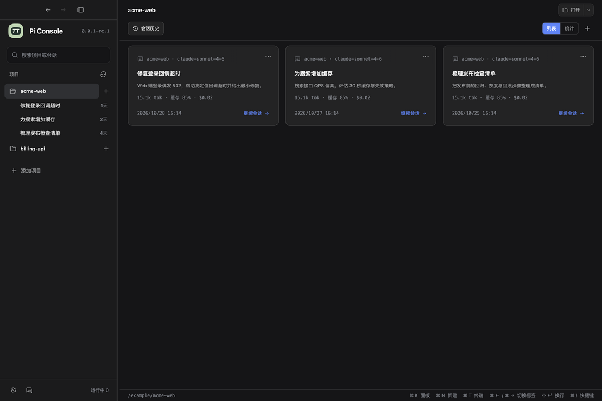

# Pi Console

[简体中文](README.md) · English

A macOS desktop app for managing multiple [Pi](https://pi.dev) sessions. Organize sessions by project, use Pi in tabs, and keep tasks running when you leave.



## Why Pi Console?

When you work across projects, it can be hard to find the right terminal, see which task is done, or pick up an old conversation. Pi Console puts projects, history, and running sessions in one place.

It is not a replacement agent: **your local Pi still handles conversations, models, tools, and context.**

## Features

- Discover Pi history, add projects, and search, favorite, pin, rename, or fork sessions.
- Run multiple Pi tabs per project and jump to sessions needing attention with `⌘J`.
- On quit, choose whether to keep Pi processes running and reconnect next time, or end them.
- View local session counts, tokens, cache, and estimated cost. These are not billing records.
- Keep your existing Pi models, extensions, skills, and settings. The app supports Chinese, English, and light/dark themes.

## Install

Currently available for **macOS Apple Silicon** only.

1. Install and configure [Pi](https://pi.dev); make sure `pi` starts in your terminal.
2. Download the latest macOS Apple Silicon ZIP from [Releases](https://github.com/lsfcy/pi-console/releases).
3. Extract it, move `Pi Console.app` to Applications, and open it. If macOS blocks it, follow the prompt in System Settings → Privacy & Security.

To verify the download, put `SHA256SUMS.txt` in the same directory and run `shasum -a 256 -c SHA256SUMS.txt` in a terminal.

The app is ad-hoc signed, **not Developer ID signed or notarized**. It checks GitHub for new releases at startup and hourly while running; disable this or check manually in Settings → About. Downloads and installation remain manual.

## Use

Choose or add a project, then use its `+` button to start Pi or reopen a session from history. Local file links reveal the item in Finder; they do not execute it.

`⌘W` ends the current Pi process, with confirmation for active work. When quitting with `⌘Q`, choose whether to keep or end managed Pi processes. Closing the window only hides the app.

| Action | Shortcut |
|---|---|
| Command palette | `⌘K` |
| New / temporary session | `⌘N` / `⌘⇧N` |
| Previous / next tab | `⌘←` / `⌘→` |
| Previous / next sidebar session | `⌘↑` / `⌘↓` |
| First ten visible projects | `⌘1`–`⌘9`, `⌘0` |
| Next / previous session needing attention | `⌘J` / `⌘⇧J` |
| Open project in Terminal | `⌘T` |
| Settings / shortcuts | `⌘,` / `⌘/` |

Drag a project name or its grip in the sidebar to reorder projects; the order is saved on release. Pinned projects reorder within their pinned group. Move up / Move down are also available in the project’s context menu.

A skippable quick-start guide appears on first launch. Reopen it from Settings → Quick start; it shows your current shortcut bindings.

Hold `⌘` for **0.5 seconds** to see navigation hints. Shortcuts can be changed in Settings. The app uses `⌘` plus arrow keys for navigation; ordinary text fields keep their native editing behavior.

## How it works and data

Each session runs as a local Pi terminal process. If you choose to keep processes on quit, a local relay holds each terminal, and the app reconnects through a restricted Unix socket. Pi processes in other terminal apps are not managed.

- Pi history is normally read from `~/.pi/agent/sessions`, including Pi's configured session directory. Viewing and statistics do not rewrite history; deletion uses the system Trash.
- Projects, settings, and restore metadata are stored in `~/Library/Application Support/Pi Session Console/`. Background processes continue to use resources until stopped.
- The app has no cloud sync and does not store model credentials or proactively upload sessions. It checks public GitHub releases at startup and hourly while running by default; disable this in Settings. Pi, model providers, and installed extensions may use the network.
- Local file links reveal the item in Finder without executing it. Check the source before opening files.

See [architecture](docs/architecture.md) and [security](SECURITY.md).

## Development

Node.js 22.12+, Xcode Command Line Tools, and a working Pi installation are required:

```sh
npm ci
npm start
```

`npm run sandbox` uses a separate profile. Run `npm run check` before contributing; Electron and real PTY tests need a macOS GUI environment. See [CONTRIBUTING.md](CONTRIBUTING.md).

## Limitations

There is no Linux or Windows package, built-in split view, or automatic update installation. Pi runs in fullscreen terminal mode; terminal image protocols are disabled. Pi tools have the current user's permissions: **this app is not a security sandbox**.

## License

[MIT](LICENSE). Pi is a separate project under its own license.
